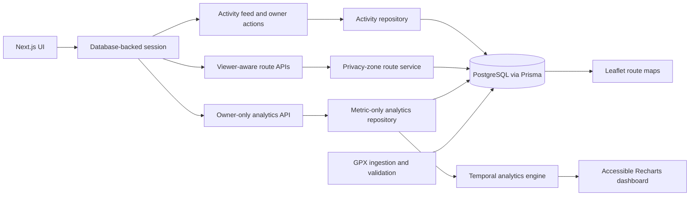

# Paceboard

Paceboard is a five-project, Strava-inspired full-stack application built to demonstrate tested UI architecture, relational persistence, GPS processing, privacy-safe geospatial design, and reliable training analytics.

## Engineering progression

1. Project 1 established a typed activity domain, repository boundary, tested activity feed, derived metrics, and accessible interaction states.
2. Project 2 replaced fixtures with PostgreSQL and Prisma, added database-backed sessions, owner-authorized mutations, persistent Kudos, and concurrency-focused integration tests.
3. Project 3 added GPX ingestion, coordinate validation, persisted GPS routes, route-distance checks, and Leaflet visualization.
4. Project 4 added privacy zones, deterministic route transformation, viewer-aware route DTOs, owner-only full routes, public safe-route sharing, and privacy regression tests.
5. Project 5 adds owner-scoped training analytics, weighted pace, explicit timezone conversion, Monday-based weekly mileage, four-week trends, accessible charts, and deterministic calendar-boundary evidence.

## Consolidated architecture

## Final capabilities

- Authenticated activity creation, editing, deletion, sessions, and persistent Kudos
- GPX ingestion, GPS validation, persisted routes, and Leaflet maps
- Privacy zones with owner-only full geometry and sanitized public route sharing
- Owner-only training summaries with weighted pace and explicit units
- Monday-to-Sunday weekly mileage in a selected IANA timezone
- Empty-week filling, week-over-week changes, and four-week rolling mileage
- Privacy-safe DTOs that exclude coordinates from aggregate responses
- Vitest unit coverage plus real PostgreSQL integration tests

## Local verification

1. Start Docker Desktop and the repository's existing Docker Compose services.
2. Install the locked dependencies with `npm install`.
3. Run `npm test`.
4. Run `npm run build`.
5. Start Paceboard, sign in, and open `/analytics`.

## Correctness policies

- Activity instants are stored in UTC.
- Calendar grouping converts each instant into the selected IANA timezone before deriving its local Monday.
- Distance is accumulated as integer hundredths of miles before display rounding.
- Weighted pace is total eligible duration divided by total eligible distance.
- Analytics queries require the authenticated owner ID and select metric fields without GPS relations.
- Personalized analytics responses use `Cache-Control: private, no-store`.

## Boundary-bug evidence

The Secret Mission preserves a naive UTC grouping result and its repaired local-calendar result. The fixture proves that a run occurring Sunday at 11:30 PM in `America/New_York` can already have a Monday UTC date. The corrected engine keeps all 12.00 miles in the expected local week, assigns every activity exactly once, and returns identical output on repeated aggregation.

Detailed policy, test output, build output, and before-and-after values belong in `docs/training-analytics.md`.

## Production limitations

- The focused analytics engine aggregates a bounded range in application memory. Higher-volume deployments should use database pre-aggregation or maintained summary tables.
- Timezone and range choices are request parameters, not persisted user preferences.
- Local Docker Compose is the verified runtime. Production deployment, distributed caching, background jobs, and observability infrastructure are outside this series.
- The projects demonstrate production-style boundaries and tests, but they remain an educational portfolio implementation rather than a fully operated commercial fitness platform.