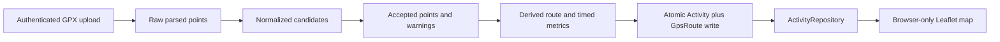

# Paceboard GPS Pipeline

## gps-v1 policy

- Maximum file size: 1,000,000 bytes.
- Maximum points: 20,000.
- Coordinates: six decimal places; latitude -90 through 90; longitude -180 inclusive to 180 exclusive.
- Elevation: meters, two decimal places; missing pairs are skipped for gain.
- Timestamps: timezone-bearing ISO values; missing or invalid values break timed intervals.
- Impossible jump: a timed segment above 12 meters per second drops its endpoint.
- Distance: Haversine with the policy's 6,371,000 meter radius.
- Final conversion: 1 mile equals exactly 1,609.344 meters. Round only final database fields.

## Storage decision

JSON points keep this project readable and preserve optional elevation, time, and warning metadata without adding one row per point. Individual point rows would support point-level SQL but add many writes and joins. Encoded polylines are compact but lossy and need explicit precision during decoding. PostGIS LineString plus GiST becomes valuable when Project 4 needs spatial predicates such as nearby-route or privacy-zone queries. Project 3 only replays whole routes, so PostGIS would add setup without improving the learning target.

## Limitations

The contract supports one GPX 1.1 track and one segment. It rejects routes, waypoints, multiple tracks, multiple segments, tracks without a positive timed interval, files above 1 MB, and files above 20,000 points. The upload path buffers multipart data and is not intended for large files. OpenStreetMap tiles are best-effort and have no SLA. Route privacy, spatial queries, background jobs, large-file streaming, and production tile infrastructure belong to Project 4.

## Corruption experiment evidence

The secret corruption test creates a new point array with spread syntax, so `referencePoints` remains unchanged.

### Before gps-v1

`deriveNaiveMetrics()` accepts every numeric coordinate. The impossible jump makes naive distance more than 100 times the repaired route distance.

### After gps-v1

- `IMPOSSIBLE_JUMP` excludes source index 3 from accepted geometry.
- `DUPLICATE_TIMESTAMP` at source index 6 breaks its adjacent timed intervals.
- `MISSING_TIMESTAMP` at source index 8 breaks its adjacent timed intervals.
- `MISSING_ELEVATION` at source index 9 preserves the point geometry.
- The elevation pair beside source index 9 is excluded from gain.
- Repaired route distance remains within 15 meters of the 900-meter reference.
- Repaired elapsed time is less than 540 seconds because broken timed intervals are excluded.
- Processing the same parsed input twice returns deeply equal results.