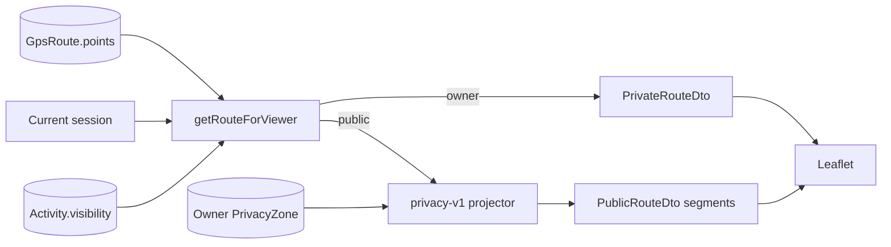

# Paceboard GPS Privacy Threat Model

Assets: complete coordinates, timing, elevation, warnings, zones, ownership, and visibility.

Controls:

- Object authorization on every request.
- Explicit public property allowlist.
- Server-side projection.
- Segment flush at each protected point.
- `Cache-Control: no-store` and current database reads.
- Owner ID in every mutation filter.
- Project 3 upload and point bounds plus bounded zone settings.

Residual risk: sparse routes, recognizable landmarks, timing correlation, screenshots, and previously exported data may still reveal locations. Defer PostGIS, simplification, benchmarks, jobs, rate limits, audit logs, analytics, and production tile infrastructure.